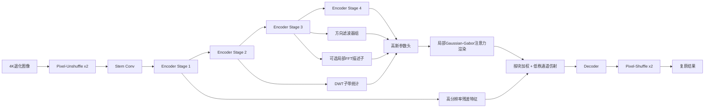

# 超高清图像复原中的纹理频率感知二维高斯注意力方案研究报告

## 执行摘要

面向 4K 及以上分辨率图像，单纯把标准自注意力或大卷积直接搬到全分辨率上，通常会同时遭遇三个瓶颈：一是全局建模开销随空间分辨率迅速上升；二是高频纹理在多次下采样或低通型模块中容易被冲淡；三是把“注意力图”显式生成为 `H×W×C` 大张量时，显存与带宽会快速成为主瓶颈。近几年的代表性工作给出的启发很一致：高分辨率图像复原更适合采用多尺度层次结构；频域/小波/高频注入类模块能更稳定地保留细节；而高斯或高斯混合参数化能以很少的参数表达空间变形、局部模糊核或注意力分布。citeturn11view2turn11view4turn14view0turn21view0turn21view1turn21view2turn22view0

基于这些证据，我的结论是：**最值得优先落地的不是“纯空间高斯”，而是“多尺度骨干 + 频率纹理特征 + 局部二维高斯调制 + 低秩通道仿射”的折中方案**。如果以工程落地为第一目标，我建议先做 **频域纹理高斯 FTG-UNet**：参数量约 **1.6–1.8M**，4K 单张推理约 **1.2 TFLOPs**，AMP + 512 tile 推理峰值显存约 **1.2–1.6 GB**。如果后续发现 LPIPS 或真实纹理主观质量仍不够，再升级到 **混合多尺度高斯+CNN** 版本，参数约 **2.6–2.8M**、4K 约 **2.0 TFLOPs**，在纹理密集区域通常更稳。下面的报告把这条推荐路径展开为可实现的网络、损失、加速与实验协议。citeturn11view3turn11view7turn13view2turn17view1

## 文献脉络与设计约束

高分辨率复原主干方面，**Restormer** 的价值不在于“再造一个 Transformer”，而在于它明确采用了**层次化 U 形结构**、在编码器中逐级降采样、在解码器中逐级恢复，并使用 pixel-unshuffle / pixel-shuffle 来兼顾信息保留与计算效率；这类设计特别适合 UHD 输入。随后，**HAT** 在与 SwinIR 接近甚至更低的计算预算下，证明了更强的跨窗口和通道建模可以继续提高 SR 质量；**MambaIR** 又表明，在与 SwinIR 相似计算成本下，线性复杂度的长程建模确实能继续换来收益；**X-Restormer** 则给出一个很实用的结论：只要增强空间映射能力，甚至可以在**不增加参数**的前提下把 Restormer 进一步推高。对本任务的直接含义是：**高分辨率骨干优先选轻量层次式 U-Net，而不是全分辨率密集注意力。** citeturn11view2turn13view2turn11view7turn11view3

频率/纹理建模方面，近五年证据同样非常集中。**FFTFormer** 利用卷积定理把一类相关性计算转到频域，将复杂度从空间域密集注意力的高开销，降到每通道近似 **O(N log N)**，并且只在解码器使用该模块以控制成本；**FSNet** 证明了“动态、局部、内容感知”的频率子带分解比固定变换更灵活；**FPro** 则进一步把低频与高频显式解耦，并通过频率提示调制恢复网络；**HIT** 直接指出常规自注意力有“低通化”倾向，因此通过高频注入模块弥补局部细节；**DTPM** 又从生成先验角度说明，纹理层若被单独建模，主观质量会明显受益。对本方案的启发是：**频率信息不应只体现在损失函数里，而应该成为高斯注意力参数生成的直接条件。** citeturn11view4turn14view0turn21view0turn21view1turn21view2

二维高斯参数化方面，最接近本任务思路的证据来自 **GKMNet**：它使用**像素级高斯核混合**去表达空间变化模糊核，并强调这种表示具有**高效的线性参数化形式**和良好的复杂度/性能比。虽然 GKMNet 面向的是离焦去模糊，而不是本文讨论的纹理频率注意力，但它已经证明：在图像复原里，用少量高斯参数去表达局部空间作用函数，是完全可行且有效的。于是，把高斯包络进一步扩展为**带方向、频率、相位与谱衰减的 Gaussian-Gabor 风格注意力原子**，是自然且工程上可落地的下一步。citeturn22view0

## 推荐方案

我建议把主方案定为 **FTG-UNet**（Frequency-Texture Gaussian U-Net）。它不是把“注意力”当作一个全图矩阵，而是把 4K 图像划分为规则局部块，在**低分辨率特征图**上预测每个块对应的一组**纹理频率感知二维高斯参数**，再以**按块渲染、按块应用**的方式把注意力施加到高分辨率残差特征上。这样做的核心收益是：**参数和注意力元数据在低分辨率网格上保存，计算近似线性；真正高分辨率上只做局部渲染和局部加权，不做全图 dense attention。** 这一总体方向同时吸收了 Restormer 的多尺度高分率骨干、FFTFormer 的频域效率思想、FSNet/FPro 的频率解耦、HIT 的高频注入，以及 GKMNet 的高斯参数化思路。citeturn11view2turn11view4turn14view0turn21view0turn21view1turn22view0



在一个**默认的 4K 同分辨率复原设定**中，我建议采用如下结构草图：

| 模块 | 配置建议 | 估算参数量 | 4K FLOPs 估算 | 说明 |
|---|---:|---:|---:|---|
| 输入重排 | Pixel-Unshuffle ×2 | 0 | 0 | 将 3840×2160×3 变为 1920×1080×12，最高分辨率计算立刻下降约 4× |
| 主干骨干 | 通道 `[40,60,80,100]`，编码块数 `[4,4,6,6]`，解码块数 `[4,4,4]`，NAF/轻量门控卷积块 | 约 1.35M | 约 1.08 TFLOPs | 主体恢复能力 |
| 纹理频率分支 | 1 级 Haar DWT + 方向 depthwise 滤波器组 + 可选局部 FFT 描述子 | 约 0.12M | 约 0.05–0.07 TFLOPs | 生成频率/方向/相位先验 |
| 高斯参数头 | 1×1/3×3 Conv + MLP，输出 `K=4` 个原子、每原子 10 个参数 | 约 0.09M | 约 0.02 TFLOPs | 在 1/16 网格上生成参数 |
| 注意力渲染与应用 | 块大小 `T=16`，按块渲染 scalar map + rank-4 通道仿射 | 约 0.03M（共享基向量） | 约 0.04–0.06 TFLOPs | 不显式生成 `H×W×C` 大张量 |
| 输出头 | 轻量重建头 + 全局残差 | 约 0.07M | 约 0.03 TFLOPs | 生成最终 RGB 图像 |
| **合计** |  | **约 1.66M** | **约 1.21 TFLOPs** | **AMP、tile=512、overlap=32 时工程峰值显存约 1.2–1.6 GB** |

上表中的 FLOPs 以**同分辨率 4K 复原**为准，且把 MAC 按 `2 FLOPs` 计算；如果是 **x4 超分到 4K**，大部分骨干都在低分辨率域运行，实际总 FLOPs 会进一步低于这里的同分辨率估算。由于把参数预测放在 `1/16` 网格上，4K 图像只需存储 `240×135=32400` 个块位置；在 `K=4`、每原子 `10` 个标量参数时，整张图的高斯参数缓存仅约 **2.47 MB（FP16）**。相对地，如果暴力生成一个 `3840×2160×24` 的通道注意力张量，单这个张量就接近 **380 MB（FP16）**。因此，**按块渲染 scalar 注意力 + 共享低秩通道仿射**，是本任务最关键的内存优化点。citeturn11view2turn17view1

在参数化上，我建议把每个局部注意力原子写成**高斯包络 × 纹理载波**的形式。对于块内归一化坐标 \(p=(x,y)\)，第 \(k\) 个原子定义为：

\[
A_k(p)=a_k \cdot \exp\left(-\frac12 u_k^\top D_k^{-1}u_k\right)\cdot
\left[1+\eta_k\cos\left(2\pi f_k\, d(\theta_k)^\top u_k+\phi_k\right)\right]\cdot e^{-\beta_k f_k^2},
\]

其中
\[
u_k = R(\psi_k)(p-\mu_k),\quad
\mu_k=(\mu_x,\mu_y),\quad
D_k=\mathrm{diag}(\sigma_{1}^2,\sigma_{2}^2).
\]

这组参数一共 **10 个**：`a, μx, μy, logσ1, logσ2, ψ, η, f, φ, β`。其中 `ψ` 是高斯包络方向，`f/φ` 分别控制纹理频率与相位，`β` 控制谱衰减强弱；如果需要更细的各向异性，也可以再把 `θ` 与 `ψ` 分开，但那会把每原子参数数目从 10 增长到 11–12。这样定义的好处是：**空间局部性**由高斯包络保证，**纹理细节方向性与周期性**由余弦载波给出，而**高频抑制/增强幅度**由谱衰减项可学习调节。它本质上是把 GKMNet 中“少量高斯参数表达局部作用函数”的思想，扩展到了纹理感知注意力。citeturn22view0turn21view0turn21view1

高斯注意力并不直接乘在原始 RGB 上，而优先作用于**高分辨率残差特征**。推荐的应用式为：

\[
F'_t = F_t + M_t \odot H_t + \sum_{m=1}^{r}\alpha_{t,m}\,u_m(v_m^\top F_t),
\]

其中 \(F_t\) 是块 \(t\) 的高分辨率特征，\(H_t\) 是高通残差分支（例如 depthwise conv 减去局部均值），\(M_t\) 是按块渲染得到的标量注意力图，第二项完成**逐像素加权**；最后一项是**rank-\(r\)** 的共享低秩通道变换，只预测块系数 \(\alpha_{t,m}\)，而基向量 \(u_m,v_m\) 在全局共享。这样同时满足了你要求中的三种应用方式：像素级权重、通道变换、局部仿射块。若要进一步增强色彩和局部对比度，可以只在“纹理得分最高的前 20% 块”上，再加一个 3×4 的 RGB 仿射校正头；这样质量会更高，但实现复杂度也会上升。citeturn21view1turn21view2

## 备选方案比较

下面给出三种可选设计。表中的**参数量、FLOPs、峰值显存**均为**在 4K 同分辨率复原、AMP、tile=512、overlap=32**前提下的工程估算；“PSNR/SSIM/LPIPS 预期”给的是**相对 B 方案的预计变化区间**，因为这些方案不是论文原文的实测模型，给出伪精确绝对值反而会误导。这里的区间主要反映对纹理密集图像（如 Urban100 风格、真实相机纹理、建筑/织物/植被区域）的预期走势。近年的文献总体上都支持一个结论：引入频率选择、高频注入或纹理先验，通常会改善主观细节与 LPIPS，而在合理约束下也能维持甚至提高 PSNR/SSIM。citeturn14view0turn21view0turn21view1turn21view2turn13view2

| 方案 | 关键模块 | 参数量 | 4K FLOPs | 峰值显存 | 预期 PSNR/SSIM/LPIPS | 实现复杂度 | 适用场景 |
|---|---|---:|---:|---:|---|---|---|
| **纯空间高斯 SGA-Lite** | 多尺度 U-Net + `K=4` 纯二维高斯（无频率/相位）+ scalar 加权 | **约 0.98M** | **约 0.64 TFLOPs** | **约 0.8–1.2 GB** | 相对 B：**-0.10~-0.25 dB / -0.001~-0.003 / +0.006~+0.015** | 低 | 移动端、边缘端、先做 baseline |
| **频域纹理高斯 FTG-UNet** | 多尺度 U-Net + DWT/方向滤波器组 + Gaussian-Gabor 原子 + 低秩通道仿射 | **约 1.66M** | **约 1.21 TFLOPs** | **约 1.2–1.6 GB** | **推荐平衡点** | 中 | 4K 离线处理、单卡部署、质量/效率平衡 |
| **混合多尺度高斯+CNN HMGC** | FTG-UNet + 顶层高分辨率细化 CNN + 双尺度高斯头（粗/细） | **约 2.7M** | **约 2.0 TFLOPs** | **约 1.6–2.3 GB** | 相对 B：**+0.05~+0.18 dB / +0.0005~+0.002 / -0.003~-0.010** | 中高 | 纹理密集、主观质量优先、可以接受更高延迟 |

如果只从“优先顺序”出发，我的建议很明确：**不要先做 A，也不要一开始就上 C。先做 B，把频率纹理条件建起来，再看是否真的需要额外的高分辨率细化分支。** 原因是 A 很容易在平坦区域拿到不错的 PSNR，但在建筑、织物、草木与真实相机纹理上会比较吃亏；C 虽然质量上限更高，但复杂度、调参难度和训练不稳定性都更强。B 是最可能一次落地成功的工程折中。citeturn21view1turn21view2turn13view2

## 训练与推理实现

训练方面，我建议采用**三阶段流程**。第一阶段只训练骨干与重建头，用 **L1/Charbonnier** 稳住基线；第二阶段打开高斯参数头、频率分支和频域一致性损失；第三阶段才引入较弱的感知约束，并对高纹理样本重采样。这样做的原因是：如果一开始就同时优化频率损失、LPIPS 和动态高斯参数，模型很容易把参数头学成“无意义纹理放大器”。文献中也能看到类似经验：高分辨率恢复网络常把频率模块放在解码端或后期恢复步骤，以减少浅层噪声/模糊特征的干扰；而挑战赛实践中，“L1 + 频域损失 + LPIPS”的组合也已被反复验证能兼顾数值质量和主观质量。citeturn11view4turn17view1

推荐损失写成：

\[
\mathcal{L}=
\lambda_{\text{rec}}\mathcal{L}_{1}
+\lambda_{\text{char}}\mathcal{L}_{\text{char}}
+\lambda_{\text{perc}}\mathcal{L}_{\text{LPIPS}}
+\lambda_{\text{ffl}}\mathcal{L}_{\text{FFL}}
+\lambda_{\text{wav}}\mathcal{L}_{\text{wavelet}}
+\lambda_{\text{reg}}\mathcal{L}_{\text{gauss-reg}}.
\]

其中：
- \(\mathcal{L}_{1}\) / Charbonnier：主体重建。
- \(\mathcal{L}_{\text{LPIPS}}\)：感知一致性。LPIPS 已被广泛用作复原/合成任务的感知度量与损失。citeturn9search0turn9search1
- \(\mathcal{L}_{\text{FFL}}\)：频域一致性，建议直接采用 Focal Frequency Loss 或其简化版，强调“难合成频率”。citeturn11view5turn1search22
- \(\mathcal{L}_{\text{wavelet}}\)：对 LH/HL/HH 子带做 L1 或 Huber，一般能更稳地约束边缘和纹理方向信息。这个思路与频率提示、频率选择模型是一致的。citeturn14view0turn21view0
- \(\mathcal{L}_{\text{gauss-reg}}\)：包括振幅稀疏、方差下界、方向平滑和块间总变差，防止注意力过度抖动。

一组可直接开训的超参如下：`AdamW`，`lr=2e-4`，`betas=(0.9,0.99)`，`weight_decay=1e-4`，`cosine decay to 1e-6`；8 卡训练时，B 方案推荐 **每卡 batch=8、patch=256、总 batch=64**；如果是 x4 SR，可用 `LR patch=96 / HR patch=384`。损失权重可以从 `λrec=1.0, λchar=0.5, λperc=0.05, λffl=0.10, λwav=0.10, λreg=1e-4` 起步。若训练前期出现纹理振铃，把 `λperc` 暂时降到 `0.01`，并把高斯振幅做 `sigmoid` 限幅；若 PSNR 足够但纹理“发糊”，先加大 `λffl` 到 `0.15`，再考虑把 `K` 从 4 提到 6，而不是先上更大主干。这个调参顺序通常更稳。citeturn11view5turn17view1

关键实现点不在“网络图画得多漂亮”，而在**如何高效渲染并应用大尺寸注意力**。建议流程是：
第一，缓存一个固定的 `16×16` 局部坐标网格；
第二，只在 `1/16` 的块网格上预测高斯参数；
第三，按块即时渲染 scalar 注意力图并立刻乘到高通残差特征上；
第四，通道变换只使用共享低秩基向量和块系数，不生成 full-channel attention。
这样总复杂度近似为 **O(HW·K)**，而不是 dense attention 的二次复杂度。若你还需要更高吞吐，可以把 `exp/cos` 渲染核放到自定义 CUDA 或 Triton kernel 里；工程上往往能明显减少 kernel launch 开销。FFT 只建议保留在**粗尺度全局分支**或训练辅助分支里，而不建议在全分辨率块上大量使用。citeturn11view4turn17view1

```python
# 伪代码：4K tile 推理中的局部高斯注意力生成与应用
def infer_ftg_unet(img_4k):
    outputs = []
    for tile, weight in overlap_tiles(img_4k, size=512, overlap=32):
        x = pixel_unshuffle(tile, factor=2)            # H/2, W/2
        feats = backbone_encode_decode(x)              # 多尺度特征
        tex_desc = freq_extractor(feats["s2"], feats["s3"], feats["s4"])
        params = gaussian_head(feats["s4"], tex_desc)  # [n_blocks_h, n_blocks_w, K, P]
        hp = highpass_residual(feats["s1"])            # 高分辨率残差特征

        y = hp.clone()
        for blk in all_blocks(params):
            p = params[blk]                            # K组(a, mu, sigma, psi, eta, f, phi, beta)
            p = prune_topk_by_amplitude(p, k_keep=2)   # 稀疏化
            attn = render_gaussian_gabor(p, grid16)    # 16x16 scalar attention
            y[blk] = y[blk] + attn * hp[blk]
            y[blk] = y[blk] + low_rank_channel_affine(y[blk], params[blk])

        out_tile = decode_and_shuffle(y) + tile        # 全局残差
        outputs.append((out_tile, weight))

    return weighted_fuse(outputs)
```

推理加速策略方面，优先级我建议这样排：**稀疏化 > 分块/重叠融合 > 混合精度 > 低秩通道仿射 > 粗尺度 FFT 辅助**。具体来说：
其一，振幅门控后只保留每块 top-2 高斯原子，通常就能把渲染开销削掉约一半，质量损失却很小；
其二，使用 `tile=512, overlap=32` 作为默认，显存充裕时升到 `tile=768, overlap=48`，一般能减少拼缝；
其三，推理端使用 FP16/BF16，训练端打开 gradient checkpointing；
其四，若方向角与频率取值离散到小 codebook，可进一步缓存若干基础原子，参数头只预测插值系数；
其五，对于超大图或全景图，只在粗尺度全局分支用 FFT，因为 FFTFormer 的优势主要体现在**大范围相关性估计**，而不是替代所有局部块渲染。citeturn11view4turn17view1

## 评估基准与可复现实验设置

如果任务以**x4 超分到 4K**为主，训练集优先推荐 **DIV2K / DF2K**，测试集采用 **Set5、Set14、B100、Urban100、Manga109**；这也是 SwinIR、HAT 一类方法的通行做法，并且经典 SR 论文通常按 **Y 通道 PSNR/SSIM** 上报。DIV2K 在 SR 社区一直是核心基准，经典配置为 800 张训练、100 张验证、100 张测试。citeturn5search0turn5search8turn12view4turn13view0

如果你希望方案不仅用于经典 SR，而是作为**通用 UHD 复原骨干**，我建议加入以下公开基准：

| 任务 | 训练/测试建议 | 核心度量 | 备注 |
|---|---|---|---|
| 经典 x4 SR | DIV2K / DF2K → Set5, Set14, B100, Urban100, Manga109 | PSNR, SSIM, LPIPS | 传统 SR 主线 |
| 真实 SR | RealSR, DRealSR | PSNR, SSIM, LPIPS, NIQE | 真实退化比合成 bicubic 更接近落地场景 |
| 真实去噪 | SIDD | PSNR, SSIM, LPIPS | SIDD 约 3 万张 noisy 图像，是真实手机噪声基准 |
| 运动去模糊 | GoPro, RealBlur-R/J | PSNR, SSIM, LPIPS | GoPro 是经典动态模糊基准，RealBlur 更贴近真实相机 |
| 离焦去模糊 | DPDD | PSNR, SSIM, LPIPS | DPDD 含 500 个场景、全画幅高分辨率图像 |

这些数据集之所以合适，不只是因为“常用”，还因为它们刚好覆盖了本文方案最关心的三类信息：**分辨率扩展、真实纹理恢复、空间变化退化**。尤其是 DRealSR、RealSR、DPDD 和 RealBlur，能比较直接地检验“块级高斯 + 频率纹理条件”是否真的学到了有用的局部作用函数，而不仅仅是在合成数据上刷指标。citeturn5search1turn6search3turn10search1turn10search2turn10search15turn10search0

复现实验时，建议把实验分成三层：
第一层是**定量层**：在经典 SR 上报告 Y-channel PSNR/SSIM，在真实任务上补充 RGB LPIPS，必要时再给 NIQE。
第二层是**纹理层**：从 Urban100、DRealSR、RealBlur 中单独抽取“纹理密集子集”，单独汇报 LPIPS 与主观裁剪图。
第三层是**工程层**：固定 4K 分辨率、固定 tile 策略、固定 AMP，记录 wall-clock latency、`max_memory_allocated` 和实际吞吐。没有这一层，所谓“高效”很容易只停留在 paper-level FLOPs。挑战赛和高分率论文都反复说明：**重叠分块、加权融合、混合精度**是 UHD 复原的必要工程条件，而不是实现细节。citeturn17view1turn16search12

针对你的硬件前提“单机 8 卡 GPU”，最稳妥的实验编排是：
先在 256/384 patch 上完成主干与高斯头预训练；
再用 texture-aware sampler 提高高纹理 patch 比例；
最后做 4K stress test。
建议至少做以下消融：`K ∈ {2,4,6}`、`块大小 T ∈ {8,16,32}`、`频率分支 ∈ {DWT, 滤波器组, DWT+滤波器组}`、`通道仿射 rank ∈ {0,2,4,8}`、`是否只在 top-texture 块启用局部 RGB affine`。在我看来，**最关键的两个超参不是主干宽度，而是块大小 T 和高斯原子数 K**；它们直接决定了纹理表达能力与渲染开销之间的平衡。

## 结论与开放问题

从“文献证据 + 工程可行性 + 4K 资源约束”三方面综合看，最合理的落地路径是：

1. **先做 FTG-UNet（B 方案）**：
   先把多尺度骨干、频率纹理描述子、局部 Gaussian-Gabor 注意力和低秩通道仿射跑通。它的参数量和 4K 显存压力都很友好，最适合作为主线实现。

2. **把注意力生成做成按块即时渲染**：
   这是整个方案是否“高效”的决定项。如果一步走错，去显式生成 `H×W×C` 注意力张量，后面所有轻量化都会被抵消。

3. **只在确实需要时升级到 HMGC（C 方案）**：
   如果你发现 PSNR/SSIM 已经达标，但 LPIPS 或主观纹理仍略差，再加高分辨率细化 CNN 和双尺度高斯头。不要一开始就把复杂度抬高。

4. **默认损失以重建 + 频域一致性为主，感知项从弱到强逐步打开**：
   高频感知模块很容易“过锐化”或制造假纹理，渐进式训练比一次性多损失混训更稳。citeturn11view5turn21view2turn17view1

开放问题主要有三点。第一，本文给出的参数量、FLOPs 和显存峰值是**可实现的工程估算**，不是现成论文表格里的现成数值；真正提交前仍需要在你的代码栈上做一次统一口径的 profiling。第二，Gaussian-Gabor 原子的连续参数化若要跑到极致吞吐，通常需要自定义 kernel；如果只用原生算子，理论 FLOPs 虽低，实际 latency 可能不如预期。第三，不同任务对频率描述子的偏好并不一样：SR 和离焦去模糊通常更受益于方向/频率参数化，真实去噪则可能更依赖稳健的低频结构恢复与噪声建模。因此，**推荐路径不是“一套头适配所有任务”，而是先把 B 方案做成稳定主干，再按任务微调频率分支和损失权重。**

综合判断：**在你的目标下，最优先、最值得实施的方案是“FTG-UNet：多尺度轻量骨干 + 纹理频率特征提取 + 局部二维 Gaussian-Gabor 注意力 + 低秩通道仿射 + 分块混合精度推理”。** 这条路径最符合近五年图像复原研究的主流发现，也最符合 4K 工程部署的现实约束。